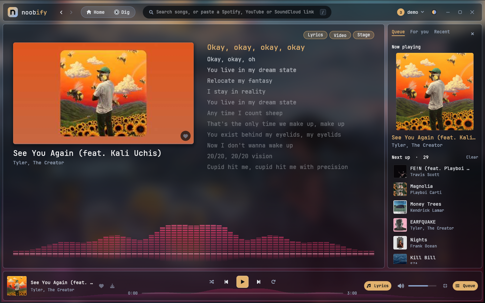
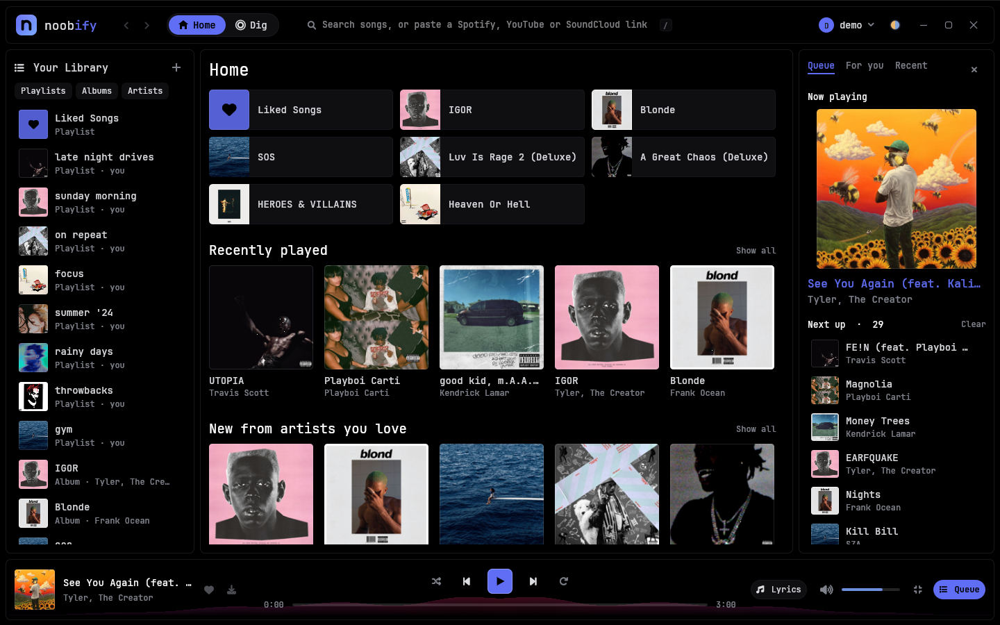
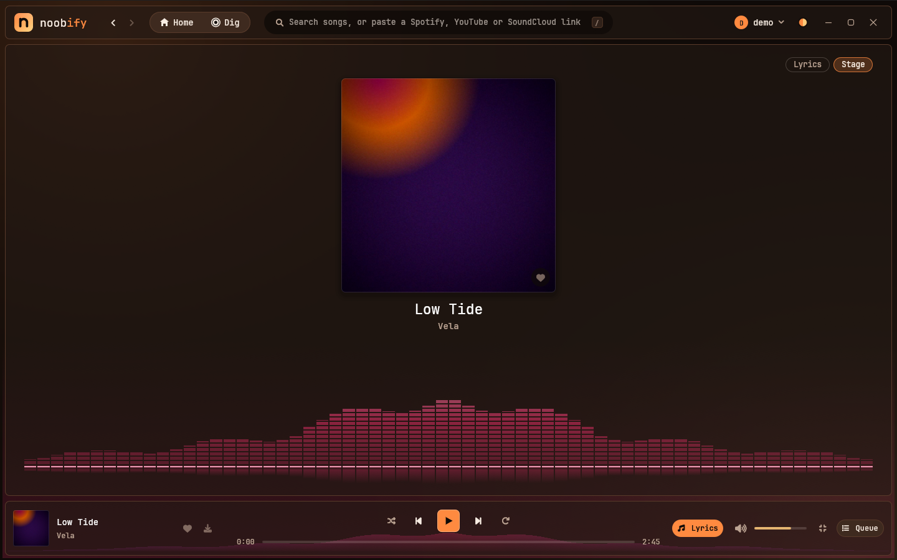
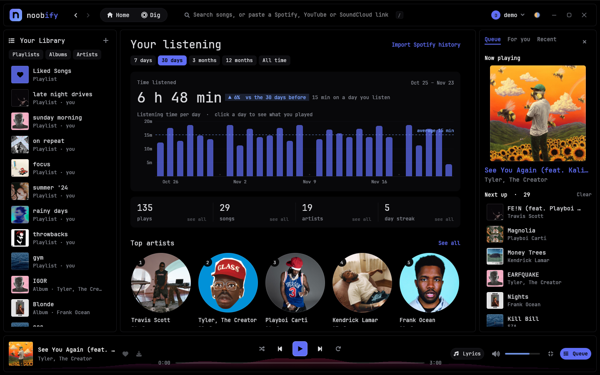
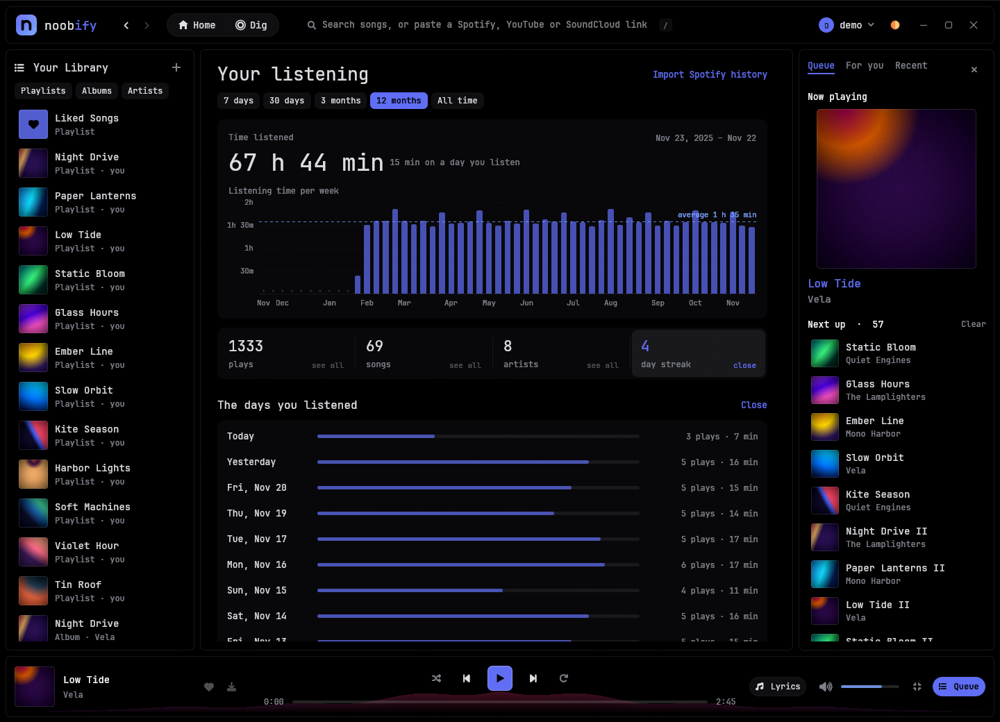
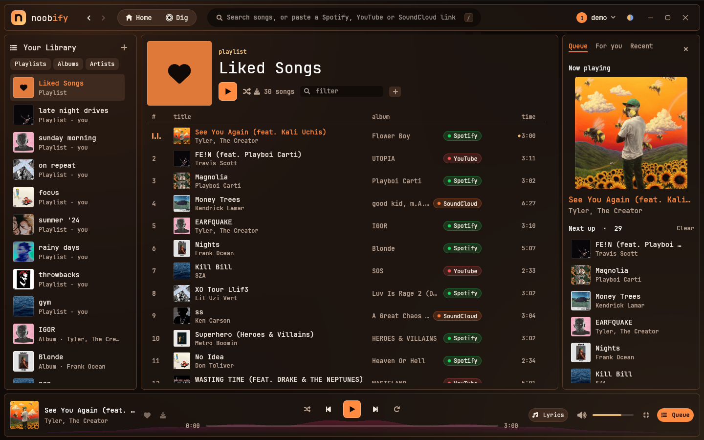

<p align="center">
  
</p>

<h1 align="center">noobify</h1>

<p align="center">
  A free music player for Windows. YouTube and SoundCloud in one place, plus your Spotify library if you want it.
</p>

<p align="center">
  <a href="https://github.com/Xylloz/noobify-releases/releases/latest"><b>Download the latest version</b></a>
</p>

<p align="center">
  
</p>

## Why

Most of the music people listen to is on YouTube, but YouTube isn't a music player.
There's no real library, the queue gets in your way, and half the results are the wrong
version of the song. The Spotify desktop app has the library, but it's heavy, and a lot of
music just isn't on it.

So we made the player we wanted: a proper music player built on YouTube and SoundCloud,
with a library, a queue, synced lyrics and your song on Discord. Sign in with Spotify and
your playlists and liked songs come along. Don't, and everything else still works.

It's free and open source. No account, no ads, and it never asks for admin rights.

<table>
  <tr>
    <td width="50%"></td>
    <td width="50%"></td>
  </tr>
  <tr>
    <td align="center"><sub><b>Home</b> · Midnight</sub></td>
    <td align="center"><sub><b>Stage visualiser</b> · Ember</sub></td>
  </tr>
</table>

## What makes it different

**It plays the real song.** Search YouTube for a song and half the results are sped-up
edits, lyric videos, live versions and covers. noobify skips all of that and finds the
actual record. If it ever picks the wrong one, right-click the song, choose another
upload, and it'll remember your pick from then on.

**Your Spotify, YouTube and SoundCloud music, all in one place.** Your Spotify
playlists, liked songs and artist pages sit right next to anything from YouTube and
SoundCloud, in one library and one queue. Even playlists with thousands of songs open
right away, and after the first time they open instantly. Local files in your Spotify
playlists play too, matched from YouTube. noobify only reads your Spotify account and
never changes anything on it.

**Listen along with friends on Discord, for free.** Your Discord status shows what you're
playing, cover and all. Friends hit Join and hear the same song at the same moment,
pauses and skips included. Nobody needs Premium. If a friend doesn't have noobify yet,
clicking your song sends them here.

**Lyrics and videos that actually line up.** Lyrics come from
[LRCLIB](https://lrclib.net) and follow the song line by line, or word by word when the
timing's there. Turn on the video and the song's official music video plays in time with
the record. You still hear the album version, not the video's edit.

**Finds music you haven't heard yet.** The Dig is a set of crates to flip through by
sound, place and era, plus Discogs records sorted by how few people own them. For you
builds suggestions from what you actually play, and leaves out mashups, karaoke and
sped-up versions unless you play those yourself.

**Your stats, any time.** Think Wrapped, but whenever you want. See time listened, top
artists and songs, every play, your streak and which days you listened, for a week, a
month, a year or all time. Import your Spotify history and start with years of it.

**Built for Windows, and light on it.** It's a native app, not a website in a box. It
starts fast and stays small. Settings shows how much memory it's using and what you can
turn down. Songs you've played are kept on your PC, so they start instantly the next time.

## Everything else

### Your music

- **Paste any playlist link.** Spotify, YouTube or SoundCloud. Drop it in the search box
  and it opens like any other playlist. Play it, save it, or pick out the songs you want.
- **Your own playlists.** They live on your PC and can mix songs from anywhere.
- **Chapters.** Long mixes on YouTube and SoundCloud show their tracklist, so you can jump
  straight to a song.
- **Downloads.** Save any song as an MP3 or WAV.
- **Last.fm.** Connect it and noobify scrobbles for you.

### Make it yours

- **Themes.** Skyline, Desktop, Dark, Midnight, Light and Ember, plus visualisers and
  colours that change with each song.
- **Your wallpaper.** The Desktop theme takes its colours and backdrop from your
  wallpaper. It works with Wallpaper Engine too, and video wallpapers keep moving behind
  the player and pulse with the beat.

### Control it from anywhere

- **Right-click anything.** Every song has the same menu wherever it shows up: play it
  next, add it to a playlist, go to the artist or album, or start a song radio.
- **Keyboard shortcuts.** H for Home, D for the Dig, N for Now Playing, / to search.
- **Global hotkey.** Ctrl+Alt+Space plays or pauses from any app, most games included.
- **Media keys.** They just work, and the song shows in Windows' media panel and on the
  lock screen.

### Stays up to date

noobify checks for a new version once a day, verifies the download and installs it when
you restart. You can turn this off.

### Your listening, all in one place

<p align="center">
  
</p>

<table>
  <tr>
    <td width="50%"></td>
    <td width="50%"></td>
  </tr>
  <tr>
    <td align="center"><sub><b>A day's listening</b></sub></td>
    <td align="center"><sub><b>Liked Songs</b> · Ember</sub></td>
  </tr>
</table>

## Install

1. Open [the latest release](https://github.com/Xylloz/noobify-releases/releases/latest)
   and download `Noobify-<version>-setup.exe` (about 90 MB).
2. Run it. If Windows warns you, see below.
3. Open noobify from the Start menu.

It installs for your Windows user only, and it comes with everything it needs (yt-dlp,
ffmpeg and Deno). After that it keeps itself up to date. Installing over an older version
keeps your settings, history and saved songs.

**Want it portable?** Grab `Noobify-<version>.zip` instead. It's the same app: unzip it
anywhere and run `noobify.exe`. It'll tell you when there's a new version, but you swap
it in yourself.

## If Windows warns you

noobify isn't code signed yet, so Windows doesn't know who made it. New apps without many
downloads get flagged because of that. Free signing for open source projects through
[SignPath](https://signpath.org) is being set up.

<!-- When releases are signed, replace the paragraph above with:
noobify is signed (free code signing by SignPath.io, certificate by SignPath
Foundation). It's still new, so Windows hasn't seen many people run it yet, and
that's what the warning is about.
-->

**"Windows protected your PC"** (SmartScreen): click **More info**, then **Run anyway**.

**"Smart App Control blocked an app"**: Smart App Control only runs apps Windows already
knows, and there's no Run anyway button. You can turn it off in Windows Security, under
App & browser control. Be aware that on some versions of Windows 11 you can't turn it back
on without reinstalling Windows, so it's your call.

If an update gets blocked this way, noobify keeps working as it was and shows you where to
download the update yourself.

## Is it malware?

Fair question for a free .exe from a Discord link. Short answer: no.

Longer answer: you don't have to take our word for it. Everything is public, so you can
ask your Claude to read the whole thing. Something like:

> hey, can you check if github.com/Xylloz/noobify is safe to install?

Or check it yourself:

- **The code.** All of it is at [github.com/Xylloz/noobify](https://github.com/Xylloz/noobify),
  MIT licensed.
- **The build.** Releases aren't built on anyone's PC. Pushing a version tag starts
  [a GitHub Actions run](https://github.com/Xylloz/noobify/actions/workflows/release.yml)
  that tests and builds noobify from that exact code, packages it and publishes it here.
  Every step is in
  [`release.yml`](https://github.com/Xylloz/noobify/blob/main/.github/workflows/release.yml).
- **The checksum.** Each release's `latest.json` has the SHA-256 of its setup file. To
  check your download, run this in PowerShell and compare the result with `sha256` in
  `latest.json`:

  ```
  Get-FileHash .\Noobify-<version>-setup.exe
  ```

  noobify checks its own updates the same way before installing them.
- **VirusTotal.** Every release gets scanned, and the results are in its notes.

<!-- vt -->
VirusTotal's scan of 0.3.9.6:

- [`Noobify-0.3.9.6-setup.exe`](https://www.virustotal.com/gui/file/f0b9133cfcd34d7639e2ec73834e1b7be3fc64c9277d965d09d4d76a0d3ab00b): 0 of 66 scanners flagged it
- [`Noobify-0.3.9.6.zip`](https://www.virustotal.com/gui/file/3ff5b3f5fb2978b6236c604373acad12c16e687432fdc399e9a33f22a39ed6c2): 0 of 65 scanners flagged it
<!-- /vt -->

## What it connects to

Only what it needs for what you're doing:

- YouTube and SoundCloud, for the music
- Deezer, for song info and covers
- Discogs and MusicBrainz, for records
- LRCLIB, for lyrics
- Spotify and Last.fm, if you sign in to them

Your Discord status goes to the Discord app on your own PC.

**Listening along.** While your Discord status is on and a song is playing, noobify keeps
a room open on a small relay on Cloudflare (it's in `relay/` in the code), so friends can
hit Join. The relay passes the song, pauses and skips to whoever's listening, ten people
at most. It never sees names or accounts, and it keeps nothing but the room's key. Turn
the Discord status off and none of this happens.

**Updates.** Once a day noobify reads `latest.json` from this page to check for a new
version.

Your settings, history and saved songs stay on your PC, in `%APPDATA%\noobify`.

## Uninstalling

Go to Settings, Apps, noobify, Uninstall. It'll ask whether to delete your settings and
saved songs too.

## Something broke?

[Open an issue](https://github.com/Xylloz/noobify/issues) and include the version from
the bottom of Settings. If you have them, attach `crash.log` and `last-failure.txt` from
`%APPDATA%\noobify`.

## License

[MIT](https://github.com/Xylloz/noobify/blob/main/LICENSE). yt-dlp (Unlicense), ffmpeg
(GPL) and Deno (MIT) come with it under their own licenses, listed in `LICENSES.txt` next
to `noobify.exe`. The Skyline picture is by [catzz.work](https://catzz.work).
