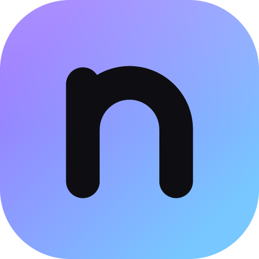

<p align="center">
  
</p>

<h1 align="center">noobify</h1>

<p align="center">
  A free music player for Windows. YouTube and SoundCloud in one place, with your Spotify library if you want it.
</p>

<p align="center">
  <a href="https://github.com/Xylloz/noobify-releases/releases/latest"><b>Download the latest version</b></a>
</p>

<!-- Screenshot: Now Playing with lyrics lit up and the music video playing.
     File: brand/now-playing.png (about 1600x1000, Skyline theme) -->
<!-- <p align="center"></p> -->

## Why

Most of what people listen to is on YouTube, but YouTube isn't a music player. noobify
is one: a library, a queue, lyrics, your song on Discord, and a good way to find new
music, all playing from YouTube and SoundCloud. Sign in with Spotify and your playlists
and liked songs come along. Skip it and everything else still works.

It's free and open source. No account, no ads, and it never asks for admin rights.

## What it does

- **Spotify if you want it**: Sign in to bring your playlists, liked songs and artist
  pages. The music itself plays from YouTube and SoundCloud. noobify only reads your
  Spotify account and never changes anything on it.
- **Paste a link**: Drop a Spotify, YouTube or SoundCloud playlist link in the search
  box and it opens as a normal playlist. Play it, save the whole thing, or pick songs out.
- **Your own playlists**: Kept on your PC, with songs from anywhere.
- **Lyrics**: Synced lyrics from [LRCLIB](https://lrclib.net) that follow the song line by
  line, or word by word when the timing is known. The next song's lyrics load while the
  current one plays.
- **Music videos**: A song's official video plays in Now Playing, in time with the record.
  You hear the record, not the video's version.
- **Listen along on Discord**: Your status shows what you're playing, like Spotify's.
  Friends can click Join and follow you song after song, pauses and skips included.
  Clicking the song on your status plays it in their noobify, or points them here if
  they don't have it yet.
- **The Dig**: Crates to flip through by sound, place and era, plus records from Discogs
  by genre, style, country and how few people own them. It leans toward music you
  haven't heard of.
- **For you**: Suggestions based on what you actually listen to. Mashups, karaoke and
  sped-up versions stay out unless you play them yourself.
- **Downloads**: Save any song as MP3 or WAV.
- **Themes**: Skyline, Desktop (colours from your wallpaper), Dark, Midnight, Light and
  Ember, plus visualisers and colours that follow each song.
- **Keyboard**: H for Home, D for the Dig, N for Now Playing, / to search. Ctrl+Alt+Space
  plays or pauses from any app, most games included. Media keys work too, and the song
  shows in Windows' media panel and on the lock screen.
- **Light on memory**: Settings shows how much memory noobify is using, what's using the
  most, and a lighter option for each.
- **Last.fm**: Scrobbles, if you connect it.
- **Updates itself**: It checks for a new version once a day, verifies the download,
  and installs it when you restart noobify. You can turn that off.

<!-- Screenshots, side by side:
     brand/playlist.png  a playlist page
     brand/dig.png       the Dig, a few crates open
     brand/discord.png   a Discord profile showing noobify with Join
-->

## Install

1. Open [the latest release](https://github.com/Xylloz/noobify-releases/releases/latest)
   and download `Noobify-<version>-setup.exe` (about 90 MB).
2. Run it. If Windows warns you, see below.
3. Open noobify from the Start menu. It installs for your Windows user only, and
   everything it needs (yt-dlp, ffmpeg and Deno) comes with it.

From then on it keeps itself up to date. Installing over an older version keeps your
settings, history and saved songs.

**Portable**: `Noobify-<version>.zip` is the same app. Unzip it anywhere and run
`noobify.exe`. It tells you when there's a new version, but you swap it in yourself.

## If Windows warns you

noobify isn't code signed yet. Free signing for open source projects through
[SignPath](https://signpath.org) is being set up. Until then Windows doesn't know who
made it, and new apps without many downloads get flagged.

<!-- When releases are signed, replace the paragraph above with:
noobify is signed (free code signing by SignPath.io, certificate by SignPath
Foundation). It's still new, so Windows hasn't seen many people run it yet, and
that's what the warning is about.
-->

**"Windows protected your PC"** (SmartScreen): click **More info**, then **Run anyway**.

**"Smart App Control blocked an app"**: Smart App Control only runs apps Windows already
knows, and there's no Run anyway button. You can turn it off in Windows Security, under
App & browser control, but on some versions of Windows 11 it can't be turned back on
without reinstalling Windows, so it's your call. If an update gets blocked this way,
noobify keeps working as it was and shows you where to download the update yourself.

## Is it malware?

Fair thing to wonder about a free .exe from a Discord link. Short answer: no. Long
answer: you don't have to take our word for it, just ask your Claude. Everything is
public, so it can read the whole thing. Something like:

> hey, can you check if github.com/Xylloz/noobify is safe to install?

If you'd rather look yourself:

- **The code**: all of it is at [github.com/Xylloz/noobify](https://github.com/Xylloz/noobify),
  MIT licensed.
- **The build**: Releases aren't built on anyone's PC. Pushing a version tag starts
  [a GitHub Actions run](https://github.com/Xylloz/noobify/actions/workflows/release.yml)
  that tests and builds noobify from that exact code, packages it, and publishes it
  here. You can read every step in
  [`release.yml`](https://github.com/Xylloz/noobify/blob/main/.github/workflows/release.yml).
- **The checksum**: Each release's `latest.json` has the SHA-256 of its setup file. To
  check your download, run this in PowerShell and compare it with `sha256` in
  `latest.json`:

  ```
  Get-FileHash .\Noobify-<version>-setup.exe
  ```

  noobify checks its own updates the same way before installing them.
- **VirusTotal**: Every release is scanned, and the result is in its notes.

<!-- vt -->
VirusTotal's scan of 0.3.9:

- [`Noobify-0.3.9-setup.exe`](https://www.virustotal.com/gui/file/bd23cdd5c6d5e357b17034aced60a5ab88bb93eefb69c2d7318ee2f54b99b264): 0 of 69 scanners flagged it
- [`Noobify-0.3.9.zip`](https://www.virustotal.com/gui/file/f36e169fc459c9a17028d53eb914b039d54fd7702069eacfb45153f86e065d1e): 0 of 64 scanners flagged it
<!-- /vt -->

## What it connects to

Only what it needs for what you're doing: YouTube, SoundCloud, Deezer (song info and
covers), Discogs and MusicBrainz (records), LRCLIB (lyrics), and Spotify or Last.fm if
you sign in to them. Your Discord status goes to the Discord app on your own PC.

While your Discord status is on and a song is playing, noobify keeps a room open on a
small relay on Cloudflare (it's in `relay/` in the code) so friends can click Join. It
passes along the song, pauses and skips to whoever's listening, ten people at most. It
never sees names or accounts and keeps nothing but the room's key. Turn the Discord
status off and none of this happens.

Once a day noobify reads `latest.json` from this page to check for updates. Your
settings, history and saved songs stay on your PC in `%APPDATA%\noobify`.

## Uninstalling

Settings, Apps, noobify, Uninstall. It asks whether to delete your settings and saved
songs too.

## Something broke?

[Open an issue](https://github.com/Xylloz/noobify/issues) with the version from the
bottom of Settings. If they exist, attach `crash.log` and `last-failure.txt` from
`%APPDATA%\noobify`.

## License

[MIT](https://github.com/Xylloz/noobify/blob/main/LICENSE). yt-dlp (Unlicense), ffmpeg
(GPL) and Deno (MIT) come with it under their own licenses, listed in `LICENSES.txt`
next to `noobify.exe`. The Skyline picture is by [catzz.work](https://catzz.work).
